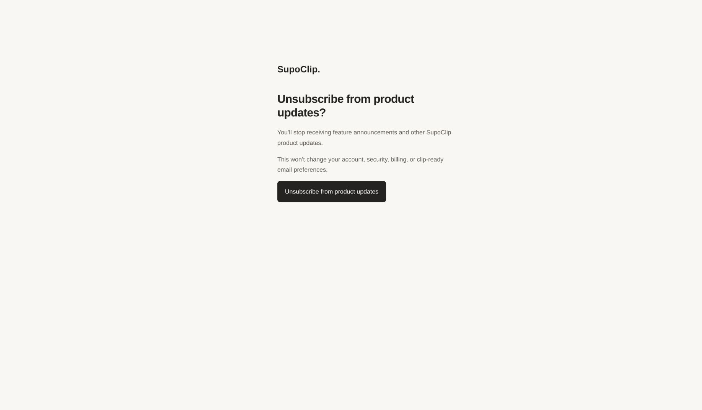
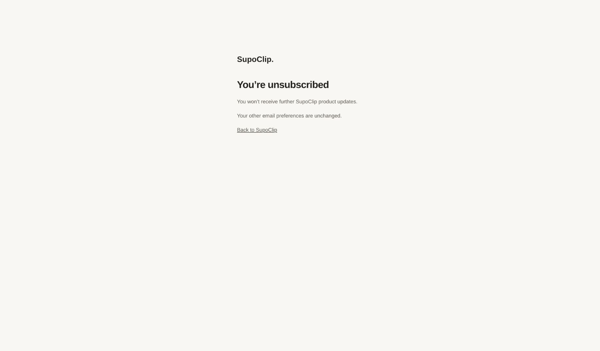

# Product-update emails

Product announcements use `ProductUpdateEmailService.send_product_update(user_id,
content)`, which re-reads the recipient’s current address and opt-out preference
before each SES send. An opted-out user returns
`{"skipped": true, "reason": "unsubscribed"}` without contacting SES. Do not send
product announcements through the transactional `SesEmailService` directly or
upload a static recipient list to SES: those paths do not check this preference.

The service fills `{{first_name}}` and `{{unsubscribe_url}}` in HTML and plain
text, or appends an unsubscribe footer when none is provided. The selected email
draft can be supplied as `EmailContent(subject, html, text)` after filling its
sender-address field. Other unresolved template fields fail before delivery.
No campaign is sent or scheduled by this change.

Each recipient gets a signed link at
`/email/product-updates/unsubscribe?token=...`. The page works without signing in.
GET displays confirmation without changing preferences, so email scanners and
link previews cannot unsubscribe a recipient. POST stores
`users.product_updates_unsubscribed_at`, including repeated POSTs. Both the page
form and mailbox one-click POSTs use the same endpoint, without a redirect,
session, or cookie. Responses are not cached and do not load analytics or third
party resources. Email addresses are not included in the URL or page.

The message also includes `List-Unsubscribe` and `List-Unsubscribe-Post` headers
using [SES v2 custom headers](https://docs.aws.amazon.com/ses/latest/APIReference-V2/API_Message.html)
and [RFC 8058](https://www.rfc-editor.org/rfc/rfc8058.html). Verify DKIM coverage
of these two headers in a delivered test email before relying on an inbox’s
one-click unsubscribe UI. The footer and confirmation page work independently.

Apply the Prisma migration `20261025160000_product_update_preferences` before
deploying the frontend. The backend has the equivalent re-runnable migration
`20261025_0004_product_update_preferences.sql`. Both runners preserve existing
opt-outs; new and existing users have a null timestamp until they unsubscribe.
`init.sql`, Prisma and SQLAlchemy describe the same nullable column.

No new environment variables are required. Sending product emails requires an
HTTPS `NEXT_PUBLIC_APP_URL` (the backend’s `app_base_url`), configured SES
credentials, and the existing `BACKEND_AUTH_SECRET`. Links are purpose-bound and
signed with that secret, are not time-limited, and become invalid if the user’s
email address or signing secret changes. Deleted users cannot be targeted.

Account verification, password resets, security notices, subscription/billing,
and clip-completion email paths are unchanged. This preference does not cancel
a subscription or change clip-completion notification settings.

## Browser verification

The confirmation and success states were checked against a disposable local
PostgreSQL database, using a test recipient and no email delivery.

